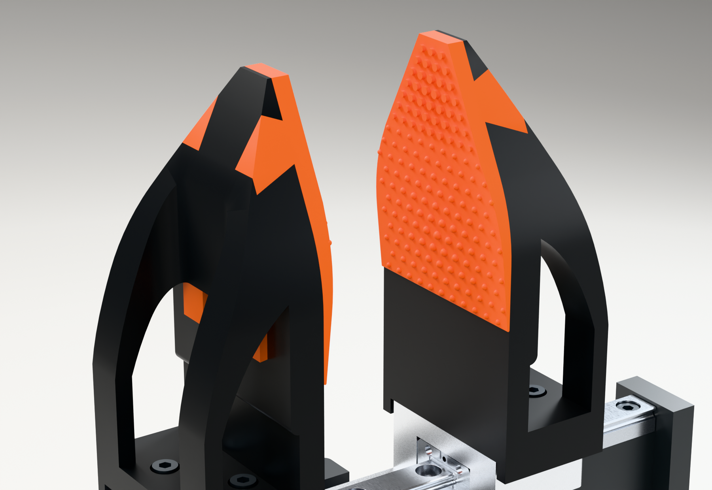

# gripper-wbot

**gripper-wbot** 是基于 Seeed Studio reBot B601-DM 改装的双指平行夹爪。一台达妙 DM4310 电机通过小齿轮驱动两根齿条，让两侧夹指同步开合。每侧夹指由定制指座和摩擦垫组成。


[Blender 渲染场景](render/gripper-studio.blend) · [FreeCAD 总装](cad/gripper.FCStd) · [STEP 总装](cad/gripper.step) · [物料表与采购链接](docs/BOM.md) · [试装记录](docs/fit.md)

## 夹指细节

橘色摩擦垫的凸点朝向夹持面。渲染中，指座采用哑光黑色外观，5052 铝合金连接件采用银色细磨砂外观。



## 打开与修改

用 FreeCAD 打开 `cad/gripper.FCStd`，可在模型树中单独选取腕端、固定支架和左右滑台。其他 CAD 软件可导入 `cad/gripper.step`。总装以毫米为单位，X 轴沿导轨，Z 轴由安装面指向指尖。当前为静态装配姿态，两块摩擦垫的最小净距为 **37.38 mm**。

两个夹指源文件在 [cad/fingers](cad/fingers) 中，左右两侧复用同一份设计。其余单件在 [cad/parts](cad/parts) 中，包括一份简化的 M3×14 圆柱头螺钉模型。电机线束的规格和数量列在物料表中。[CAD 装配示意](docs/assembly.png)

## 从零件重建

[装配位置表](cad/layout.json) 记录每个实例的零件路径、毫米平移量和按 `x, y, z, w` 排列的旋转四元数。左右滑台的分组同时包含对应齿条、滑块、指座、垫片及随动紧固件。

用包含 FreeCAD、Part 和 Import 模块的 Python 运行以下命令，即可从本地单件重新生成两种总装文件。运行前请保存总装中的手工修改，脚本会覆盖这两个文件。已使用 FreeCAD 1.1.3 验证。

```sh
python tools/build_assembly.py
```

也可从 FreeCAD 的 Python 控制台运行，将下方路径替换为项目实际位置。

```python
import runpy
runpy.run_path("/path/to/gripper-wbot/tools/build_assembly.py", run_name="__main__")
```

## 设计来源

腕端与传动机构取自 Seeed Studio 的开源硬件。2026-11-26 从整臂模型中分离夹爪和腕端接口，替换双指、更新夹指安装螺钉，并增加一个张开姿态。[上游固定版本](https://github.com/Seeed-Projects/reBot-DevArm/tree/f6451b726d75b5f8264a3ff31dea11e1fba3dd7e/hardware/reBot_B601_DM) · [来源与许可说明](NOTICE.md)
