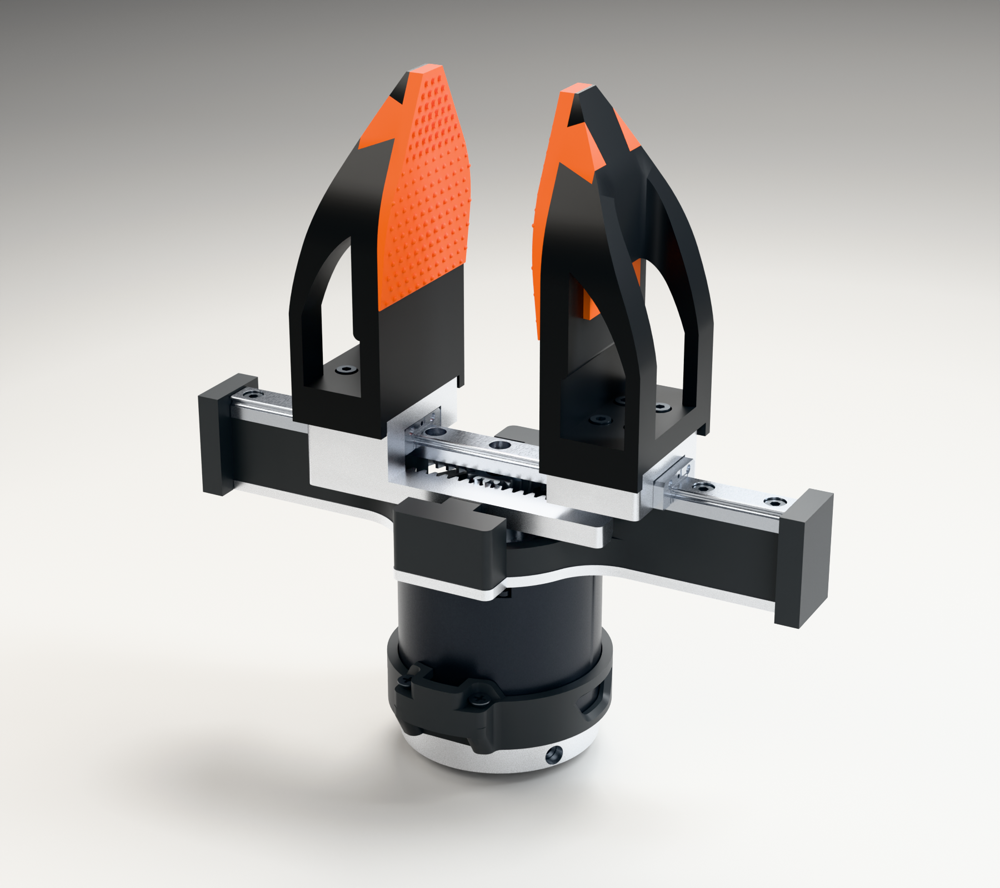
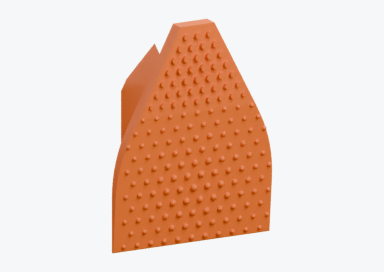
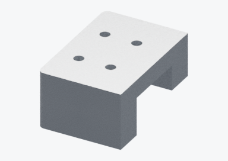
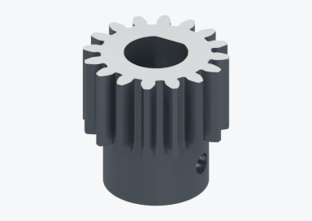
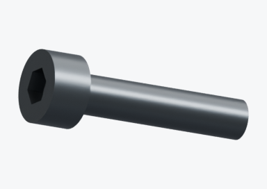
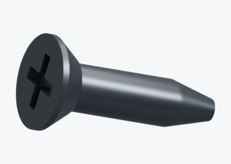
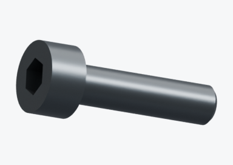
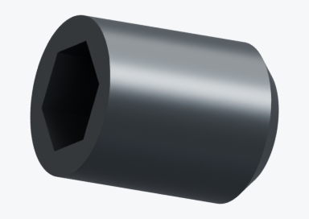

# gripper-wbot

**English** | [简体中文](README.zh-CN.md)

**gripper-wbot** is a parallel-jaw gripper. A Damiao DM4310 motor drives a pinion between two racks so the jaws open and close together.

The gripper mechanism and wrist interface are adapted from [Seeed Studio’s reBot-DevArm (B601-DM)](https://github.com/Seeed-Projects/reBot-DevArm/tree/f6451b726d75b5f8264a3ff31dea11e1fba3dd7e/hardware/reBot_B601_DM). gripper-wbot adds custom fingers, friction pads and finger mounting screws.



[Blender scene](render/gripper-studio.blend) · [FreeCAD assembly](cad/gripper.FCStd) · [STEP assembly](cad/gripper.step) · [Bill of materials](#bill-of-materials) · [Fit notes (中文)](docs/fit.md)

## Finger detail

The raised dots on the orange pads face the object being gripped. The render shows matte black fingers and satin-finished 5052 aluminium connectors.


## Printing the fingers and pads

- **Rigid finger — black PLA or PLA-CF.** Start with one PLA finger to check the four mounting holes and hex-key access to the two screws nearest the pad. Choose PLA-CF if you want a stiffer finger. For carbon-filled filament, use a wear-resistant nozzle suited to the filament manufacturer's specification. [PLA-CF material data sheet](https://store.bblcdn.eu/s8/default/aefa8303ad8d40248b0d86dfdad46518/Bambu_PLA-CF_Technical_Data_Sheet_V3.pdf)
- **Friction pad — orange TPU-85A.** The 85A designation is the Shore A hardness. Print the pad separately. Follow the filament maker’s drying instructions and use a soft-TPU profile compatible with your printer. Keep supports off the raised contact dots where possible, then install the pad with the dots facing inward. [TPU 85A material data sheet](https://cdn.shopify.com/s/files/1/0645/5876/0155/files/Bambu_TPU_85A_Technical_Data_Sheet_a7233668-497b-487f-af8a-3adb49fafaa1.pdf?v=1741314674)

Print one finger and one pad first. Check that the pad seats fully and stays in place before printing the second pair. These are prototype material recommendations. Grip force and service life still need physical testing. [Finger STEP](cad/fingers/gripper-finger.step) · [Pad STEP](cad/fingers/gripper-friction-pad.step) · [Fit notes (中文)](docs/fit.md)

## Bill of materials

Quantities cover one complete gripper, including both jaws, the motor and the wrist interface. The assembly contains 71 modeled part instances. One additional cable is listed for purchase. Each modeled part links to its own STEP file.

Part previews are rendered from the gripper CAD and scaled individually. The XT30 preview shows the connector from [Seeed Studio’s reBot B601-DM bill of materials](https://github.com/Seeed-Projects/reBot-DevArm/blob/f6451b726d75b5f8264a3ff31dea11e1fba3dd7e/hardware/reBot_B601_DM/readme.md).

### Fingers and structural parts

| Part / STEP | Illustration | Qty | Specification | Sourcing |
|---|:---:|---:|---|---|
| [Rigid finger](cad/fingers/gripper-finger.step) | [](docs/bom-images/gripper-finger.png) | 2 | FDM print in black PLA or PLA-CF. | — |
| [Friction pad](cad/fingers/gripper-friction-pad.step) | [](docs/bom-images/gripper-friction-pad.png) | 2 | FDM print separately in orange TPU-85A (Shore A 85). | — |
| [Carriage extension](cad/parts/02_Slider_Extension.step) | [](docs/bom-images/02-slider-extension.png) | 2 | CNC-machined 5052 aluminium | — |
| [Rack](cad/parts/02_Rack.step) | [](docs/bom-images/02-rack.png) | 2 | CNC-machined 5052 aluminium | — |
| [Pinion shaft adapter](cad/parts/02_Gear_Connector.step) | [](docs/bom-images/02-gear-connector.png) | 1 | CNC-machined 5052 aluminium | — |
| [Metal rail bracket](cad/parts/02_Slider_Bracket.step) | [](docs/bom-images/02-slider-bracket.png) | 1 | CNC-machined 5052 aluminium | — |
| [Printed rail support](cad/parts/01_Rail_Bracket.step) | [](docs/bom-images/01-rail-bracket.png) | 1 | PLA, 15% infill per upstream BOM | — |
| [Wrist connector A](cad/parts/02_Gripper_Connector_A.step) | [](docs/bom-images/02-gripper-connector-a.png) | 1 | CNC-machined 5052 aluminium | — |
| [Wrist connector B](cad/parts/02_Gripper_Connector_B.step) | [](docs/bom-images/02-gripper-connector-b.png) | 1 | CNC-machined 5052 aluminium | — |
| [Motor cable restraint A](cad/parts/01_Joint6_7_Cable%20Restraint_A.step) | [](docs/bom-images/01-joint6-7-cable-restraint-a.png) | 1 | ABS, 30% infill per upstream BOM | — |
| [Motor cable restraint B](cad/parts/01_Joint6_7_Cable%20Restraint_B.step) | [](docs/bom-images/01-joint6-7-cable-restraint-b.png) | 1 | ABS, 30% infill per upstream BOM | — |

### Drive and transmission

| Part / STEP | Illustration | Qty | Specification | Sourcing |
|---|:---:|---:|---|---|
| [Gripper motor](cad/parts/DM-J4310.step) | [](docs/bom-images/dm-j4310.png) | 1 | Damiao DM4310 V4 | [Supplier](https://item.taobao.com/item.htm?id=815333472865&skuId=5965481553139) |
| [Linear rail](cad/parts/RAIL-170.step) | [](docs/bom-images/rail-170.png) | 1 | MGN9, 170 mm long | [Supplier](https://item.taobao.com/item.htm?id=709992228016) |
| [Carriage block](cad/parts/SLIDER.step) | [](docs/bom-images/slider.png) | 2 | MGN9, approximately 28.9 mm long in the CAD model | [Supplier](https://item.taobao.com/item.htm?id=709992228016) |
| [Pinion with hub](cad/parts/GEAR-1M16C.step) | [](docs/bom-images/gear-1m16c.png) | 1 | Module 1, 16 teeth, 8 mm bore | [Supplier](https://item.taobao.com/item.htm?id=520920342046&skuId=4293928238550) |
| Power and CAN cable | [](docs/bom-images/xt30-2plus2.png) | 1 | XT30 2+2, female to female, 200 mm. Purchase separately for a parts build. | [Supplier](https://item.taobao.com/item.htm?id=45608377884) |

### Fasteners

| Part / STEP | Illustration | Qty | Specification | Sourcing |
|---|:---:|---:|---|---|
| [Finger mounting screw](cad/parts/M3x14_socket.step) | [](docs/bom-images/m3x14-socket.png) | 8 | M3×14 socket head, Ø5.5 mm head, 3 mm head height. Prototype selection. | — |
| [Countersunk screw](cad/parts/KM3-7.step) | [](docs/bom-images/km3-7.png) | 12 | KM3×7 | [Supplier](https://item.taobao.com/item.htm?id=613190015864&skuId=4724446993652) |
| [Self-tapping screw](cad/parts/KA3-12.step) | [](docs/bom-images/ka3-12.png) | 8 | KA3×12 | [Supplier](https://item.taobao.com/item.htm?id=37344431027&skuId=4878935333385) |
| [Socket head screw](cad/parts/HM3-6.step) | [](docs/bom-images/hm3-6.png) | 8 | HM3×6 | [Supplier](https://detail.tmall.com/item.htm?id=635755541429&skuId=5969643827976) |
| [Socket head screw](cad/parts/HM3-12.step) | [](docs/bom-images/hm3-12.png) | 7 | HM3×12 | [Supplier](https://detail.tmall.com/item.htm?id=635755541429&skuId=4551620356171) |
| [Rail mounting screw](cad/parts/HM3-26.step) | [](docs/bom-images/hm3-26.png) | 6 | HM3×26 in the assembly and kit. The upstream individual listing is for 25 mm. | [Kit list](https://www.seeedstudio.com/reBot-Arm-B601-DM-Gripper-Kit-p-6751.html) |
| [Set screw](cad/parts/S-M4-5-JIMI.step) | [](docs/bom-images/s-m4-5-jimi.png) | 2 | M4×5 | — |

## Opening and editing the assembly

Open `cad/gripper.FCStd` in FreeCAD to select the wrist, fixed frame or either carriage. For another CAD system, import `cad/gripper.step`. Dimensions are in millimetres. X follows the rail and Z runs from the mounting face toward the fingertips. The minimum pad-to-pad gap in the supplied pose is **37.38 mm**.

Both jaws use the same two [finger and pad files](cad/fingers). The [other part models](cad/parts) include a simplified M3×14 mounting screw. [Assembly view](docs/assembly.png)

## Rebuilding from individual parts

[The layout file](cad/layout.json) stores each part path, translation in millimetres and rotation quaternion in `x, y, z, w` order. Each carriage group contains its rack, slide block, rigid finger, pad and moving fasteners.

From the repository root, run the following command with a Python interpreter that can import FreeCAD, Part and Import. Save any manual assembly edits first as the script overwrites both assembly files. The build has been checked with FreeCAD 1.1.3.

```sh
python cad/build_assembly.py
```

Alternatively, run this in the FreeCAD Python console with the path to your checkout.

```python
import runpy
runpy.run_path("/path/to/gripper-wbot/cad/build_assembly.py", run_name="__main__")
```

## Design credits

The drive and wrist interface come from Seeed Studio’s open hardware. On 2026-11-26, the gripper and wrist interface were extracted from the arm assembly, fitted with replacement fingers and mounting screws, and placed in an open pose. [Upstream design revision](https://github.com/Seeed-Projects/reBot-DevArm/tree/f6451b726d75b5f8264a3ff31dea11e1fba3dd7e/hardware/reBot_B601_DM) · [Attribution and modification notice (中文)](NOTICE.md)
