# gripper-wbot

[English](README.md) | **简体中文**

**gripper-wbot** 是一款双指平行夹爪。一台达妙 DM4310 电机通过小齿轮驱动两根齿条，让两侧夹指同步开合。

夹爪传动机构和腕端接口沿用 [Seeed Studio 的 reBot-DevArm（B601-DM）设计](https://github.com/Seeed-Projects/reBot-DevArm/tree/f6451b726d75b5f8264a3ff31dea11e1fba3dd7e/hardware/reBot_B601_DM)。gripper-wbot 改用了定制夹指、摩擦垫和夹指安装螺钉。

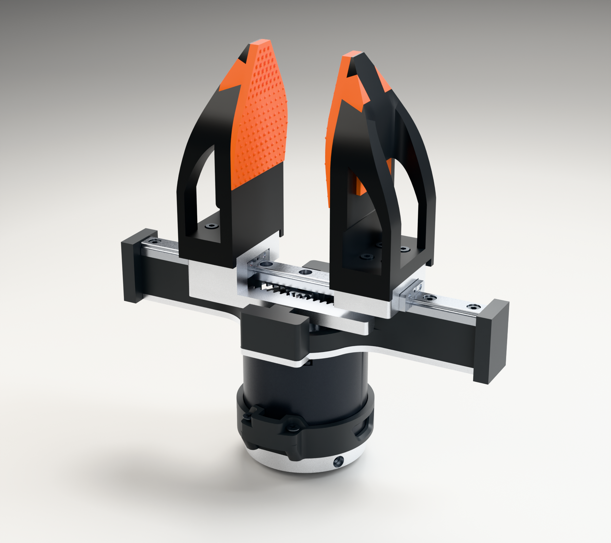

[Blender 渲染场景](render/gripper-studio.blend) · [FreeCAD 总装](cad/gripper.FCStd) · [STEP 总装](cad/gripper.step) · [单套物料表](#单套物料表) · [试装记录](docs/fit.md)

## 夹指细节

橘色摩擦垫的凸点朝向夹持面。渲染中，夹指采用哑光黑色外观，5052 铝合金连接件采用银色细磨砂外观。

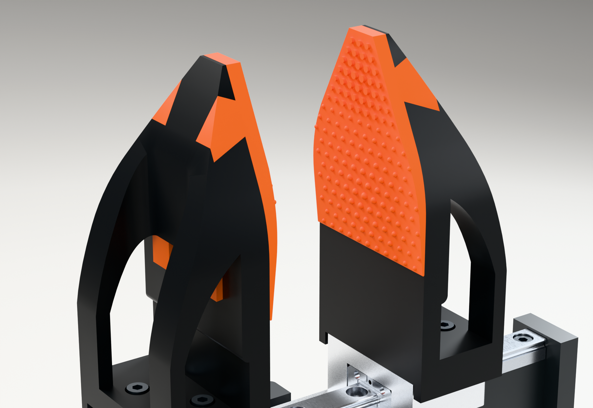

## 夹指与摩擦垫的打印建议

- 推荐用**黑色 PLA 或 PLA-CF** 打印刚性夹指。先用 PLA 打印一件，检查四个安装孔能否对齐，以及扳手能否拧到靠近摩擦垫的两颗螺钉。需要更高刚度时可选 PLA-CF，并按所用耗材的要求选用耐磨喷嘴。[PLA-CF 材料数据表](https://store.bblcdn.eu/s8/default/aefa8303ad8d40248b0d86dfdad46518/Bambu_PLA-CF_Technical_Data_Sheet_V3.pdf)
- 推荐用**橘色 TPU-85A** 打印摩擦垫，85A 是邵氏 A 硬度。将摩擦垫单独打印，按所用耗材的指引烘干并选择适配打印机的软 TPU 配置。切片时尽量避开在抓握凸点上生成支撑，安装时将凸点朝向夹持中心。[TPU 85A 材料数据表](https://cdn.shopify.com/s/files/1/0645/5876/0155/files/Bambu_TPU_85A_Technical_Data_Sheet_a7233668-497b-487f-af8a-3adb49fafaa1.pdf?v=1741314674)

先试装一件夹指和一块摩擦垫，确认垫片能完整就位并固定，再打印另一侧。以上材料为样机建议，实物夹持力和耐久性仍待验证。[夹指 STEP](cad/fingers/gripper-finger.step) · [摩擦垫 STEP](cad/fingers/gripper-friction-pad.step) · [试装记录](docs/fit.md)

## 单套物料表

数量包含双侧夹指、驱动电机和腕端接口，共 71 个已建模零件实例，另配 1 根线束。点击部件名可打开对应的 STEP 文件。[独立采购清单](docs/BOM.md)

零件示意图按各自大小单独缩放。22 种零件由夹爪 CAD 模型渲染，XT30 线束一栏展示 [Seeed Studio reBot B601-DM 原物料表](https://github.com/Seeed-Projects/reBot-DevArm/blob/f6451b726d75b5f8264a3ff31dea11e1fba3dd7e/hardware/reBot_B601_DM/readme_zh.md)中的接头示意图。

### 夹指和结构件

| 部件 / STEP | 示意图 | 数量 | 规格与备注 | 采购参考 |
|---|:---:|---:|---|---|
| [刚性夹指](cad/fingers/gripper-finger.step) | [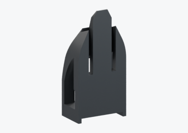](docs/bom-images/gripper-finger.png) | 2 | FDM 打印，推荐黑色 PLA 或 PLA-CF。先用一件检查安装孔位和扳手空间。 | — |
| [摩擦垫](cad/fingers/gripper-friction-pad.step) | [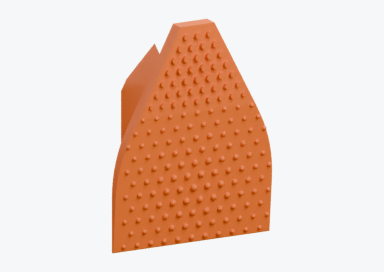](docs/bom-images/gripper-friction-pad.png) | 2 | FDM 单独打印，推荐橘色 TPU-85A（邵氏 A 硬度 85）。先试装一件，检查贴合与固定效果。 | — |
| [滑块连接件](cad/parts/02_Slider_Extension.step) | [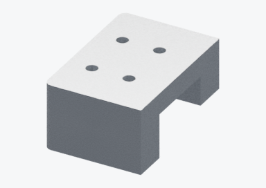](docs/bom-images/02-slider-extension.png) | 2 | 5052 铝合金，CNC | — |
| [齿条](cad/parts/02_Rack.step) | [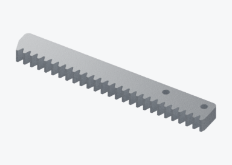](docs/bom-images/02-rack.png) | 2 | 5052 铝合金，CNC | — |
| [小齿轮连接轴](cad/parts/02_Gear_Connector.step) | [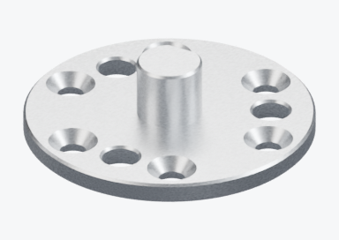](docs/bom-images/02-gear-connector.png) | 1 | 5052 铝合金，CNC | — |
| [导轨金属支架](cad/parts/02_Slider_Bracket.step) | [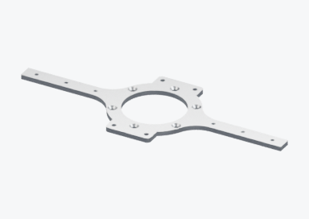](docs/bom-images/02-slider-bracket.png) | 1 | 5052 铝合金，CNC | — |
| [导轨填充支架](cad/parts/01_Rail_Bracket.step) | [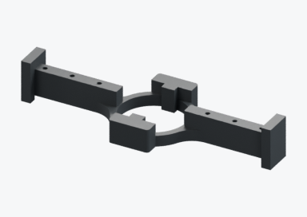](docs/bom-images/01-rail-bracket.png) | 1 | PLA，原 BOM 指定 15% 填充 | — |
| [腕端连接器 A](cad/parts/02_Gripper_Connector_A.step) | [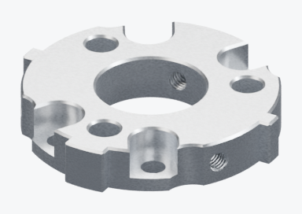](docs/bom-images/02-gripper-connector-a.png) | 1 | 5052 铝合金，CNC | — |
| [腕端连接器 B](cad/parts/02_Gripper_Connector_B.step) | [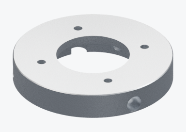](docs/bom-images/02-gripper-connector-b.png) | 1 | 5052 铝合金，CNC | — |
| [电机线束卡扣 A](cad/parts/01_Joint6_7_Cable%20Restraint_A.step) | [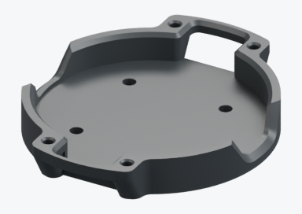](docs/bom-images/01-joint6-7-cable-restraint-a.png) | 1 | ABS，原 BOM 指定 30% 填充 | — |
| [电机线束卡扣 B](cad/parts/01_Joint6_7_Cable%20Restraint_B.step) | [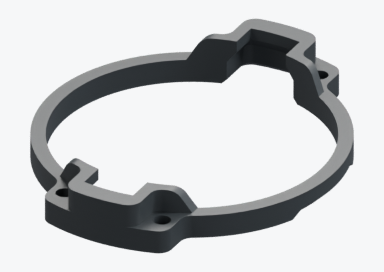](docs/bom-images/01-joint6-7-cable-restraint-b.png) | 1 | ABS，原 BOM 指定 30% 填充 | — |

### 驱动与传动

| 部件 / STEP | 示意图 | 数量 | 规格与备注 | 采购参考 |
|---|:---:|---:|---|---|
| [夹爪电机](cad/parts/DM-J4310.step) | [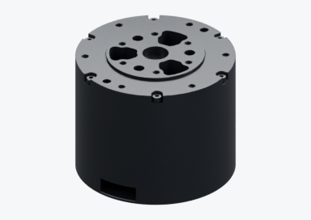](docs/bom-images/dm-j4310.png) | 1 | 达妙 DM4310 V4 | [商品页](https://item.taobao.com/item.htm?id=815333472865&skuId=5965481553139) |
| [直线导轨](cad/parts/RAIL-170.step) | [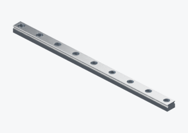](docs/bom-images/rail-170.png) | 1 | MGN9，长 170 mm | [商品页](https://item.taobao.com/item.htm?id=709992228016) |
| [导轨滑块](cad/parts/SLIDER.step) | [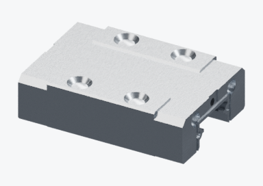](docs/bom-images/slider.png) | 2 | MGN9，模型长度约 28.9 mm | [商品页](https://item.taobao.com/item.htm?id=709992228016) |
| [带凸台小齿轮](cad/parts/GEAR-1M16C.step) | [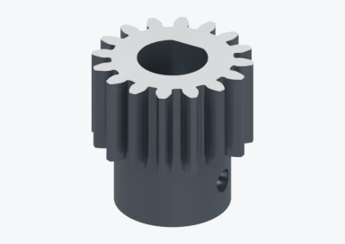](docs/bom-images/gear-1m16c.png) | 1 | 1 模、16 齿、内孔 8 mm，总装模型与中文 BOM 一致 | [商品页](https://item.taobao.com/item.htm?id=520920342046&skuId=4293928238550) |
| 电源与 CAN 一体线束 | [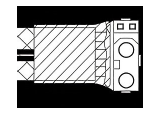](docs/bom-images/xt30-2plus2.png) | 1 | XT30 2+2，母对母，长 200 mm。采购项，未建模。 | [商品页](https://item.taobao.com/item.htm?id=45608377884) |

### 紧固件

| 部件 / STEP | 示意图 | 数量 | 规格与备注 | 采购参考 |
|---|:---:|---:|---|---|
| [夹指安装螺钉](cad/parts/M3x14_socket.step) | [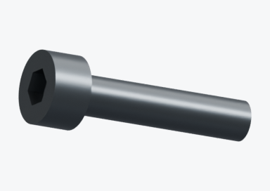](docs/bom-images/m3x14-socket.png) | 8 | M3×14 圆柱头内六角，头径 5.5 mm，高 3 mm。样机候选，见试装说明。 | — |
| [沉头螺钉](cad/parts/KM3-7.step) | [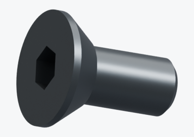](docs/bom-images/km3-7.png) | 12 | KM3×7 | [商品页](https://item.taobao.com/item.htm?id=613190015864&skuId=4724446993652) |
| [自攻螺钉](cad/parts/KA3-12.step) | [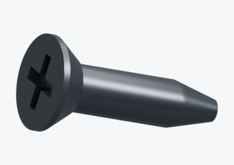](docs/bom-images/ka3-12.png) | 8 | KA3×12 | [商品页](https://item.taobao.com/item.htm?id=37344431027&skuId=4878935333385) |
| [内六角螺钉](cad/parts/HM3-6.step) | [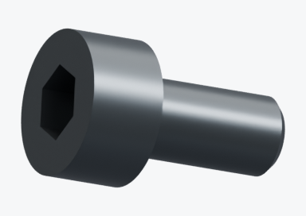](docs/bom-images/hm3-6.png) | 8 | HM3×6 | [商品页](https://detail.tmall.com/item.htm?id=635755541429&skuId=5969643827976) |
| [内六角螺钉](cad/parts/HM3-12.step) | [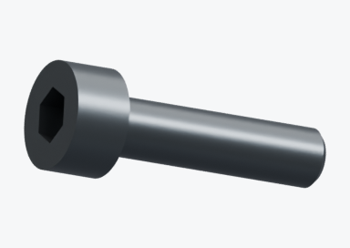](docs/bom-images/hm3-12.png) | 7 | HM3×12 | [商品页](https://detail.tmall.com/item.htm?id=635755541429&skuId=4551620356171) |
| [导轨固定螺钉](cad/parts/HM3-26.step) | [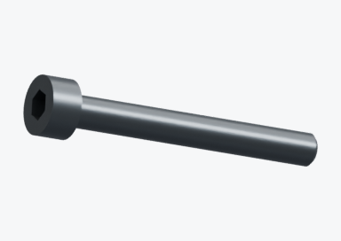](docs/bom-images/hm3-26.png) | 6 | HM3×26。总装和官方套件均为 26 mm，整臂中文 BOM 的单品为 25 mm。 | [套件清单](https://www.seeedstudio.com/reBot-Arm-B601-DM-Gripper-Kit-p-6751.html) |
| [紧定螺钉](cad/parts/S-M4-5-JIMI.step) | [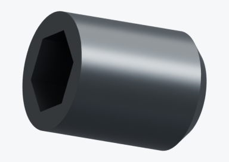](docs/bom-images/s-m4-5-jimi.png) | 2 | M4×5 | — |

## 打开与修改

用 FreeCAD 打开 `cad/gripper.FCStd`，可在模型树中单独选取腕端、固定支架和左右滑台。其他 CAD 软件可导入 `cad/gripper.step`。总装以毫米为单位，X 轴沿导轨，Z 轴由安装面指向指尖。当前为静态装配姿态，两块摩擦垫的最小净距为 **37.38 mm**。

两个夹指源文件在 [cad/fingers](cad/fingers) 中，左右两侧复用同一份设计。其余单件在 [cad/parts](cad/parts) 中，包括一份简化的 M3×14 圆柱头螺钉模型。电机线束的规格和数量列在物料表中。[CAD 装配示意](docs/assembly.png)

## 从零件重建

[装配位置表](cad/layout.json) 记录每个实例的零件路径、毫米平移量和按 `x, y, z, w` 排列的旋转四元数。左右滑台的分组同时包含对应齿条、滑块、夹指、垫片及随动紧固件。

用包含 FreeCAD、Part 和 Import 模块的 Python 运行以下命令，即可从本地单件重新生成两种总装文件。运行前请保存总装中的手工修改，脚本会覆盖这两个文件。已使用 FreeCAD 1.1.3 验证。

```sh
python cad/build_assembly.py
```

也可从 FreeCAD 的 Python 控制台运行，将下方路径替换为项目实际位置。

```python
import runpy
runpy.run_path("/path/to/gripper-wbot/cad/build_assembly.py", run_name="__main__")
```

## 设计来源

腕端与传动机构取自 Seeed Studio 的开源硬件。2026-11-26 从整臂模型中分离夹爪和腕端接口，替换双指、更新夹指安装螺钉，并增加一个张开姿态。[上游固定版本](https://github.com/Seeed-Projects/reBot-DevArm/tree/f6451b726d75b5f8264a3ff31dea11e1fba3dd7e/hardware/reBot_B601_DM) · [来源与许可说明](NOTICE.md)
