# 单套夹爪物料表

用量包括夹爪本体、驱动电机和 Link6 腕端接口。每个 STEP 链接对应一种零件。电机线束单列为实物采购项。

夹爪传动机构和腕端接口沿用 [Seeed Studio 的 reBot-DevArm（B601-DM）设计](https://github.com/Seeed-Projects/reBot-DevArm/tree/f6451b726d75b5f8264a3ff31dea11e1fba3dd7e/hardware/reBot_B601_DM)。gripper-wbot 改用了定制夹指、摩擦垫和夹指安装螺钉。

零件示意图按各自大小单独缩放。22 种零件由夹爪 CAD 模型渲染，XT30 线束一栏展示 [Seeed Studio reBot B601-DM 原物料表](https://github.com/Seeed-Projects/reBot-DevArm/blob/f6451b726d75b5f8264a3ff31dea11e1fba3dd7e/hardware/reBot_B601_DM/readme_zh.md)中的接头示意图。

## 夹指和结构件

| 部件 | 示意图 | 数量 | 规格与备注 | 模型 | 采购参考 |
|---|:---:|---:|---|---|---|
| 刚性夹指 | [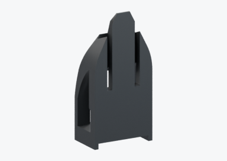](bom-images/gripper-finger.png) | 2 | FDM 打印，推荐黑色 PLA 或 PLA-CF。先用一件检查安装孔位和扳手空间。 | [gripper-finger](../cad/fingers/gripper-finger.step) | — |
| 摩擦垫 | [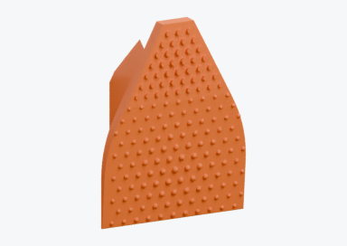](bom-images/gripper-friction-pad.png) | 2 | FDM 单独打印，推荐橘色 TPU-85A（邵氏 A 硬度 85）。先试装一件，检查贴合与固定效果。 | [gripper-friction-pad](../cad/fingers/gripper-friction-pad.step) | — |
| 滑块连接件 | [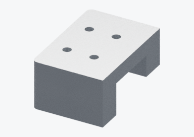](bom-images/02-slider-extension.png) | 2 | 5052 铝合金，CNC | [02_Slider_Extension](../cad/parts/02_Slider_Extension.step) | — |
| 齿条 | [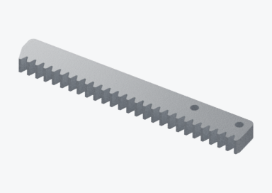](bom-images/02-rack.png) | 2 | 5052 铝合金，CNC | [02_Rack](../cad/parts/02_Rack.step) | — |
| 小齿轮连接轴 | [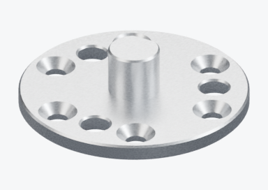](bom-images/02-gear-connector.png) | 1 | 5052 铝合金，CNC | [02_Gear_Connector](../cad/parts/02_Gear_Connector.step) | — |
| 导轨金属支架 | [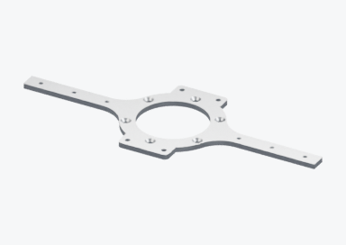](bom-images/02-slider-bracket.png) | 1 | 5052 铝合金，CNC | [02_Slider_Bracket](../cad/parts/02_Slider_Bracket.step) | — |
| 导轨填充支架 | [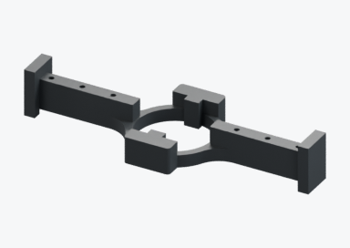](bom-images/01-rail-bracket.png) | 1 | PLA，原 BOM 指定 15% 填充 | [01_Rail_Bracket](../cad/parts/01_Rail_Bracket.step) | — |
| 腕端连接器 A | [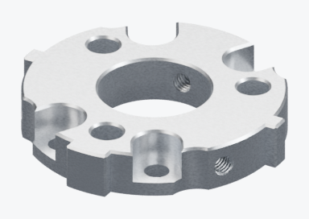](bom-images/02-gripper-connector-a.png) | 1 | 5052 铝合金，CNC | [02_Gripper_Connector_A](../cad/parts/02_Gripper_Connector_A.step) | — |
| 腕端连接器 B | [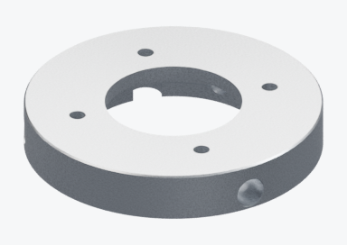](bom-images/02-gripper-connector-b.png) | 1 | 5052 铝合金，CNC | [02_Gripper_Connector_B](../cad/parts/02_Gripper_Connector_B.step) | — |
| 电机线束卡扣 A | [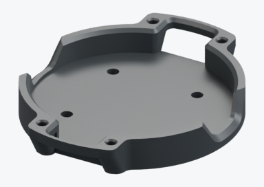](bom-images/01-joint6-7-cable-restraint-a.png) | 1 | ABS，原 BOM 指定 30% 填充 | [01_Joint6_7_Cable Restraint_A](../cad/parts/01_Joint6_7_Cable%20Restraint_A.step) | — |
| 电机线束卡扣 B | [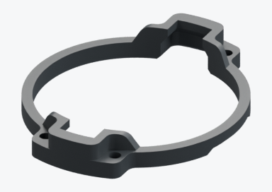](bom-images/01-joint6-7-cable-restraint-b.png) | 1 | ABS，原 BOM 指定 30% 填充 | [01_Joint6_7_Cable Restraint_B](../cad/parts/01_Joint6_7_Cable%20Restraint_B.step) | — |

## 驱动与传动

| 部件 | 示意图 | 数量 | 规格与备注 | 模型 | 采购参考 |
|---|:---:|---:|---|---|---|
| 夹爪电机 | [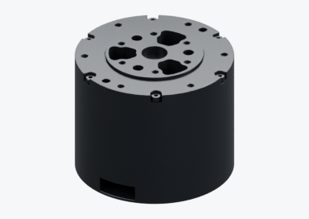](bom-images/dm-j4310.png) | 1 | 达妙 DM4310 V4 | [DM-J4310](../cad/parts/DM-J4310.step) | [商品页](https://item.taobao.com/item.htm?id=815333472865&skuId=5965481553139) |
| 直线导轨 | [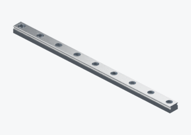](bom-images/rail-170.png) | 1 | MGN9，长 170 mm | [RAIL-170](../cad/parts/RAIL-170.step) | [商品页](https://item.taobao.com/item.htm?id=709992228016) |
| 导轨滑块 | [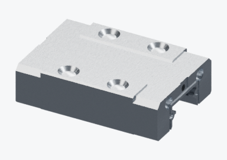](bom-images/slider.png) | 2 | MGN9，模型长度约 28.9 mm | [SLIDER](../cad/parts/SLIDER.step) | [商品页](https://item.taobao.com/item.htm?id=709992228016) |
| 带凸台小齿轮 | [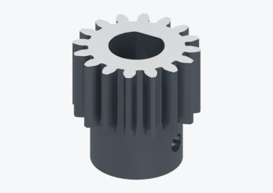](bom-images/gear-1m16c.png) | 1 | 1 模、16 齿、内孔 8 mm，总装模型与中文 BOM 一致 | [GEAR-1M16C](../cad/parts/GEAR-1M16C.step) | [商品页](https://item.taobao.com/item.htm?id=520920342046&skuId=4293928238550) |
| 电源与 CAN 一体线束 | [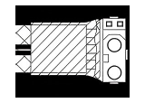](bom-images/xt30-2plus2.png) | 1 | XT30 2+2，母对母，长 200 mm。采购项，未建模。 | — | [商品页](https://item.taobao.com/item.htm?id=45608377884) |

## 紧固件

| 部件 | 示意图 | 数量 | 规格与备注 | 模型 | 采购参考 |
|---|:---:|---:|---|---|---|
| 夹指安装螺钉 | [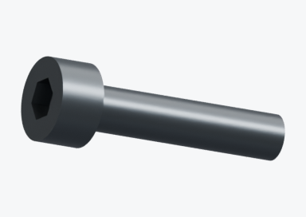](bom-images/m3x14-socket.png) | 8 | M3×14 圆柱头内六角，头径 5.5 mm，高 3 mm。样机候选，见试装说明。 | [M3x14_socket](../cad/parts/M3x14_socket.step) | — |
| 沉头螺钉 | [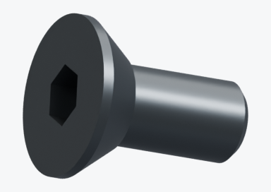](bom-images/km3-7.png) | 12 | KM3×7 | [KM3-7](../cad/parts/KM3-7.step) | [商品页](https://item.taobao.com/item.htm?id=613190015864&skuId=4724446993652) |
| 自攻螺钉 | [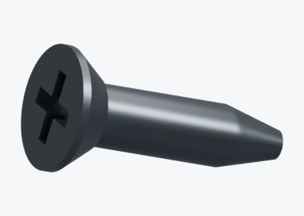](bom-images/ka3-12.png) | 8 | KA3×12 | [KA3-12](../cad/parts/KA3-12.step) | [商品页](https://item.taobao.com/item.htm?id=37344431027&skuId=4878935333385) |
| 内六角螺钉 | [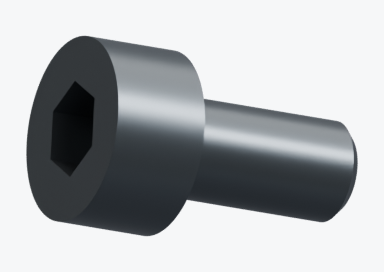](bom-images/hm3-6.png) | 8 | HM3×6 | [HM3-6](../cad/parts/HM3-6.step) | [商品页](https://detail.tmall.com/item.htm?id=635755541429&skuId=5969643827976) |
| 内六角螺钉 | [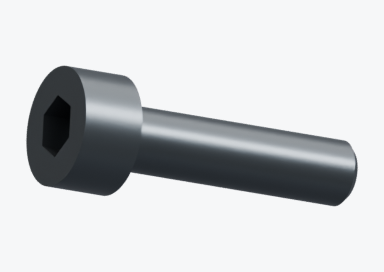](bom-images/hm3-12.png) | 7 | HM3×12 | [HM3-12](../cad/parts/HM3-12.step) | [商品页](https://detail.tmall.com/item.htm?id=635755541429&skuId=4551620356171) |
| 导轨固定螺钉 | [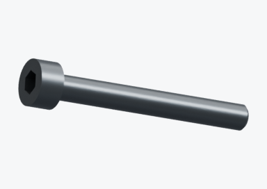](bom-images/hm3-26.png) | 6 | HM3×26。总装和官方套件均为 26 mm，整臂中文 BOM 的单品为 25 mm。 | [HM3-26](../cad/parts/HM3-26.step) | [套件清单](https://www.seeedstudio.com/reBot-Arm-B601-DM-Gripper-Kit-p-6751.html) |
| 紧定螺钉 | [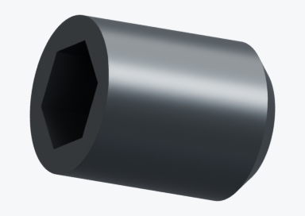](bom-images/s-m4-5-jimi.png) | 2 | M4×5 | [S-M4-5-JIMI](../cad/parts/S-M4-5-JIMI.step) | — |

商品页来自上游物料表。同一商品可能包含多个长度或型号选项。[上游中文 BOM](https://github.com/Seeed-Projects/reBot-DevArm/blob/f6451b726d75b5f8264a3ff31dea11e1fba3dd7e/hardware/reBot_B601_DM/readme_zh.md) · [官方夹爪套件](https://www.seeedstudio.com/reBot-Arm-B601-DM-Gripper-Kit-p-6751.html)
